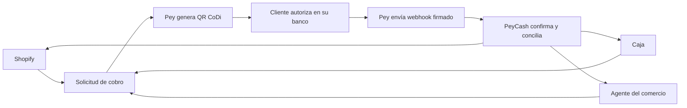

# PeyCash · alcance inicial

## Qué resuelve

Un comercio mexicano puede generar un cobro CoDi por pedido o venta sin pedir un comprobante al cliente. El mismo motor de cobros atiende ecommerce, punto de venta y ventas por chat. Pey es la única integración financiera. Primera versión en MXN y con abono directo a la cuenta CoDi del comercio.

## Funciones y criterios de aceptación

| Área | Funciones | Resultado verificable |
|---|---|---|
| Sitio público | Explicar los tres canales, ofrecer la demo y mostrar el estado de una solicitud compartida | El comprador abre el enlace sin crear una cuenta y puede ver el monto, la vigencia y el estado sin datos bancarios privados |
| Alta del comercio | Cuenta y sucursales, usuarios y roles, vinculación de credenciales Pey, validación de cuenta CoDi activa | Cada cobro usa la cuenta autorizada del comercio y cada usuario accede solo a su tienda |
| Cobros | Crear QR por venta, vincular importe y moneda al pedido o carrito, compartir enlace, consultar vigencia y generar un nuevo intento si corresponde | MXN en centavos, referencia única, importe determinado por servidor y reapertura sin duplicar solicitudes |
| Confirmación | Validar el webhook de Pey, cruzar QR, cuenta, importe y transacción, guardar auditoría y actualizar pantalla | Un evento firmado marca pagado una sola vez. Un evento repetido, inválido o de otro cobro no modifica una venta |
| Conciliación | Historial por tienda, sucursal y canal, búsqueda por folio, exportación CSV y bandeja de excepciones | El comercio puede localizar un cobro vencido, tardío, incompleto o duplicado, con acciones auditadas |
| Shopify ecommerce | Instalación y vinculación del comercio, método CoDi en checkout mediante extensión de pagos externa, redirección a PeyCash y resultado a Shopify | Un pedido MXN pasa de pago pendiente a confirmado después de un abono. El piloto nativo depende de acceso aprobado a Payments Apps API |
| Caja web | Capturar importe o usar un carrito, mostrar QR, observar confirmación y emitir un ticket comercial | La caja habilita impresión y enlace de ticket solo tras confirmar el pago. El ticket identifica venta, comercio, monto y fecha |
| Shopify POS | Botón en la cuadrícula de inicio, lectura del carrito, modal o pantalla para el QR, validación del abono, registro del pago por cajero y recibo nativo | El cajero verifica que el carrito conserve el importe cobrado, registra CoDi como método personalizado y usa el recibo de Shopify. El cierre automático se evalúa con la API y el dispositivo reales |
| Agentes | Herramientas autenticadas para solicitar cobro y consultar estado, enviar enlace o compartir QR con autorización del comercio | El agente solicita una referencia existente y devuelve un enlace. El servidor comprueba titularidad, precio y estado. El comprador autoriza en su banco y el agente solo anuncia lo confirmado |
| WhatsApp | Compartir manualmente el enlace de cobro o ticket desde la app | El usuario elige destinatario y pulsa enviar. Para envío automático habría que validar una integración de mensajería y el consentimiento del cliente |
| Devoluciones | Solicitar devolución total o parcial, folio, pendiente, rechazada o completada, registro de la transferencia saliente | Demo con devolución simulada. En el piloto, la tienda ejecuta el SPEI desde su cuenta. La aplicación conserva la referencia y reporta éxito a Shopify al verificar el abono |
| Operación | Alertas por webhook fallido, reintentos seguros y separación entre pruebas y producción | La aplicación conserva el estado durante reinicios. Un error de red no da por pagado un pedido ni reenvía dinero |

## Cómo se conectan los tres canales

### Shopify y agentes

Para ventas del ecommerce, el agente compone el carrito y comparte la URL de checkout de Shopify. Cuando la extensión de PeyCash esté aprobada y activada, el comprador elige CoDi y sigue al QR. Mantener el checkout de Shopify conserva el total, el inventario y el pedido de la tienda. Para ventas gestionadas por el propio comercio fuera del checkout de Shopify, un agente autorizado puede compartir directamente el enlace de una solicitud creada por PeyCash. Ese enlace usa el QR de Pey y muestra su estado; compartir el enlace no autoriza el pago.

El QR es útil en una pantalla de caja o equipo distinto al teléfono. Para comprar en el mismo teléfono, probaremos la notificación CoDi por número con las apps bancarias participantes. El agente no elige una CLABE, un importe libre ni puede marcar pagado o devolver fondos.

### Estados y devoluciones

- Cobro: creado → pendiente → pagado, vencido o requiere revisión. Los abonos tardíos o importes inconsistentes pasan a conciliación.
- Devolución: solicitada → transferencia pendiente → verificación → completada, o rechazada si el problema es definitivo. El importe acumulado no rebasa el abono original. Comercio y roles autorizados únicamente.
- Pey confirma la entrada de dinero. Para el piloto, la salida es una transferencia manual desde la cuenta receptora del comercio. Shopify recibe la solicitud y permite informar el resultado después, pero su documentación pública no fija cuánto puede quedar abierta esa sesión. Confirmar ese plazo con Shopify antes de ofrecer el reembolso integrado.
- Enlaces de pago: tokens no enumerables con vencimiento. La página pública muestra únicamente datos necesarios para pagar. Las credenciales y la validación de importes se quedan en el servidor.

## Cuatro semanas

| Semana | Trabajo | Prueba de salida |
|---|---|---|
| 1 | Publicar sitio y demo; activar cuenta Pey; validar QR real, webhook firmado y estados | Cobro de $0.01 MXN confirmado por Pey, webhook repetido sin doble transición y devolución identificada como simulación |
| 2 | Alta básica, roles, solicitudes con monto real del comercio, caja web, ticket y enlace de chat | Vendedor abre una venta en caja, el comprador paga y el vendedor puede imprimir o compartir ticket |
| 3 | Extensión Shopify POS en tienda de desarrollo, herramienta de agente y trabajo de acceso Shopify Payments | Demostración de QR en el dispositivo POS más registro personalizado, o caja web si no se dispone de dispositivo; agente inicia un cobro verificable |
| 4 | Piloto, reconciliación y casos límite; checkout nativo si Shopify concede acceso; preparar demo final | Validar expiración, reintento, pago tardío y devolución simulada; distinguir en el video las integraciones reales y simuladas |

La selección y revisión de Shopify Payments Partner puede exceder las cuatro semanas. Sin acceso, el checkout se muestra como prototipo y el cobro real se hace en la demo independiente. El MVP de POS contempla impresión desde la caja o recibo nativo de Shopify tras registrar el pago. El modelo comercial y los límites por comercio se definirán con datos del piloto.

## Referencias

- [Pey, API CoDi](https://docs.pey.mx/) y [términos de la API](https://pey.mx/legal/terminos-api).
- [Aprobación de apps de pagos de Shopify](https://shopify.dev/docs/apps/build/payments/payments-extension-review) y [sesiones de reembolso](https://shopify.dev/docs/apps/build/payments/request-reference#refund).
- [Extensiones de Shopify POS](https://shopify.dev/docs/apps/build/pos) y [métodos de pago de Shopify POS](https://help.shopify.com/en/manual/sell-in-person/getting-started/setup-payment-method/enable-payments).
- [Requisitos de Shopify para el checkout](https://shopify.dev/docs/apps/launch/shopify-app-store/app-store-requirements) y [Storefront Cart API](https://shopify.dev/docs/api/storefront/latest/objects/Cart).
